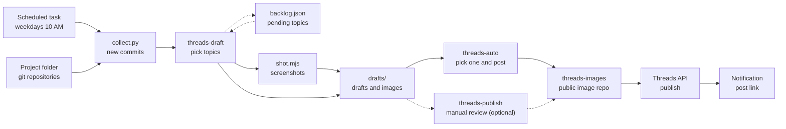

<div align="center">

<h1>thread-manager</h1>

<p>A Claude Code workflow that reads the commits in your projects, writes Threads posts, and publishes them.<br/>Every weekday it posts the best one on its own; you check what went up and delete it if needed.</p>

[](scripts/collect.py)
[](scripts/shot.mjs)
[](https://developers.facebook.com/docs/threads)
[](.claude/skills)
[](LICENSE)

[How it works](#how-it-works) · [Features](#features) · [Safety](#safety) · [Quick start](#quick-start)

[한국어](README.md) | **English**

</div>

<p align="center">
  
  <br/>
  <sub>An example draft. Drafts are written in Korean.</sub>
</p>

## About

You build something every day, but telling anyone about it keeps slipping. The commit history is full of stories, yet picking one, shaping it into a post, and taking screenshots all take time.

thread-manager takes that work off your hands. Every weekday at 10 AM, Claude reads new commits across your project folder, picks topics worth sharing, and writes drafts with images attached. It then picks the best one, publishes it through the official Threads API, and notifies you right away. You only step in to delete a post when something is wrong. Reviewing and posting drafts yourself still works too.

## How it works



1. **Collect**: `collect.py` finds every git repository under the project folder and gathers commits since the last check, along with each repository's visibility.
2. **Draft**: the `threads-draft` skill groups commits into topics and picks from them together with pending topics, using the rules in `style.md`. Topics with a UI get a screenshot of the deployed site. This step does not post.
3. **Auto-publish**: the `threads-auto` skill rechecks the drafts not yet posted, picks the best one, uploads its images to the public repository, and posts it to Threads. The post link arrives as a notification right away.
4. **Check afterwards**: if a post has a problem, delete it on Threads and say why. The reason is added to `style.md`. Drafts that were not picked can still be reviewed and posted with `threads-publish`.

## Features

- **Repository discovery**: no fixed list. The project folder is scanned on every run, so new projects are picked up automatically.
- **Topic selection**: ranks launches, new features, solved problems, and progress, and writes up to 3 drafts per run. Config changes and maintenance work are skipped.
- **Backlog**: topics pushed out by the cap are kept and reconsidered on the next run, then dropped after 14 days.
- **Images**: captures the deployed site or demo at desktop or phone size and reuses images already in the repository. Claude opens each image before deciding to use it.
- **Images, carousels, and threads**: one image becomes an image post, two or more become a carousel. Longer posts continue as replies.
- **One automatic post a day**: only the most valuable remaining draft is posted. If no draft meets the bar or something was already posted today, the run skips posting.
- **Learning from deletions and rejections**: reasons for deleting or rejecting a post accumulate in `style.md` and shape later drafts and picks.
- **Token management**: the 60-day token is refreshed automatically when posting.

## Safety

- **Auto-publishing assumes you check afterwards.** Since no one reviews posts beforehand, at most one goes up per day, and the post link is sent the moment it is published. Threads posts can be edited only for a few minutes after posting, so after that the fix is to delete. Set `auto_publish` in `config.json` to `false` to only write drafts.
- **Drafts are rechecked before posting.** When picking, the facts in the text are checked against the commits, images are opened again, and the post is compared with what was already published. A draft that fails any check is not posted.
- **Private repositories are treated differently.** Drafts from non-public repositories leave out repository links and unreleased details, and never use dev server screenshots.
- **Drafts are checked.** Missing fields, strings that look like internal paths or tokens, length (emoji counted in bytes), image format and size, and whether links in the text open are checked before posting.
- **Images become public only when posted.** Images of drafts that are not posted are never uploaded anywhere. Uploaded images stay in the public repository even if the post is deleted.
- **Runtime data stays out of git.** The token, per-repository checkpoints, backlog, and drafts are all ignored.

## Tech stack

- **Runtime**: Claude Code (project skills, scheduled tasks in the desktop app)
- **Scripts**: Python 3 standard library (`collect.py`, `threads.py`), Node.js with Playwright (`shot.mjs`)
- **External services**: Threads API, GitHub CLI (`gh`, for repository visibility and image uploads)

## Quick start

Requirements: Claude Code, Python 3, Node.js, a signed-in `gh`, and a public Threads account.

1. Clone it inside the folder that holds your projects. By default, the parent folder of this repository is treated as the project folder.
   ```bash
   cd <projects folder>
   git clone https://github.com/mivomad33/thread-manager.git
   cd thread-manager
   npm install
   npx playwright install chromium
   ```
2. In `config.json`, set `images_repo` to your own public image repository and `threads_username` to your account.
3. Get a Threads token and put it in `.env`. The steps are in the [development guide](DEVELOPMENT.en.md#getting-a-threads-token-once).
4. Check the token.
   ```bash
   python3 scripts/threads.py whoami
   ```
5. Open this folder in Claude Code, run `/threads-draft` to create drafts, then try reviewing and posting them with `/threads-publish`.
6. Once you like the results, schedule `/threads-auto` as a task to start auto-publishing.

Scheduled runs and file descriptions are covered in the [development guide](DEVELOPMENT.en.md).

## Project structure

<details>
<summary>Show folder structure</summary>

```
thread-manager/
├── .claude/skills/
│   ├── threads-draft/      # collect commits → pick topics → write drafts
│   ├── threads-auto/       # write drafts → pick one and post → notify
│   └── threads-publish/    # review drafts yourself → post approved ones only
├── scripts/
│   ├── collect.py          # new commits and repository visibility
│   ├── threads.py          # draft checks, image upload, posting, token
│   └── shot.mjs            # web page screenshots
├── drafts/                 # pending drafts and images, finished ones in archive/ (not committed)
├── config.json             # project folder, exclusions, limits, auto-publish
└── style.md                # selection rules and tone
```

</details>

## How it was built

This project was designed and built in conversation with Claude Code, and it runs on Claude Code too. Judgment and writing follow the instructions in the skill files (`SKILL.md`), while work that must be exact (collecting commits, checks, API calls) is done by scripts.

Creating the Meta developer app and getting the token were also done by Claude through the app's built-in browser. The human part was signing in, phone verification, permission to accept the terms, approving the token popup, and accepting the Threads invite.

## License

[MIT](LICENSE)
