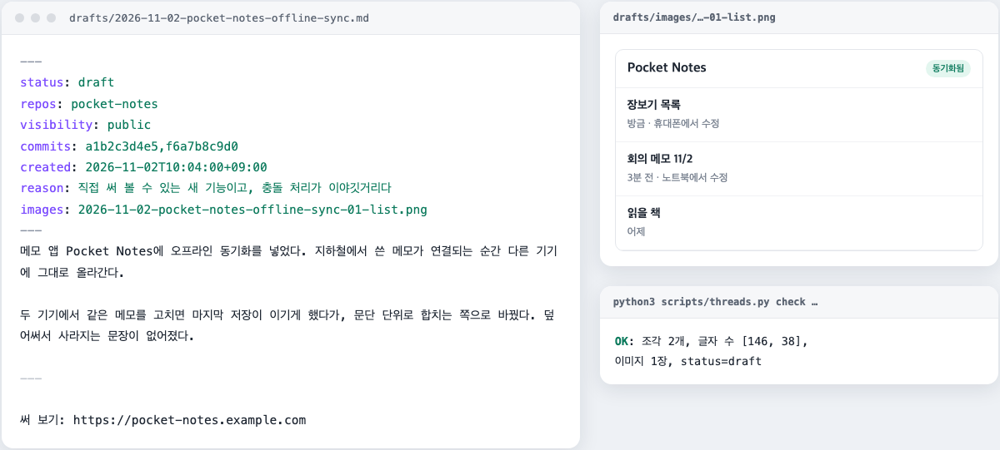
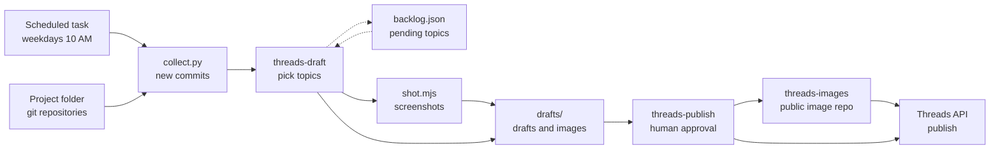

<div align="center">

<h1>thread-manager</h1>

<p>A Claude Code workflow that reads the commits in your projects and drafts Threads posts.<br/>Only posts you approve get published.</p>

[](scripts/collect.py)
[](scripts/shot.mjs)
[](https://developers.facebook.com/docs/threads)
[](.claude/skills)
[](LICENSE)

[How it works](#how-it-works) · [Features](#features) · [Safety](#safety) · [Quick start](#quick-start)

[한국어](README.md) | **English**

</div>

<p align="center">
  
  <br/>
  <sub>An example draft, made with a fictional project and fake data. Drafts are written in Korean.</sub>
</p>

## About

You build something every day, but telling anyone about it keeps slipping. The commit history is full of stories, yet picking one, shaping it into a post, and taking screenshots all take time.

thread-manager splits that work. On a schedule, Claude reads new commits across your project folder, picks topics worth sharing, and writes drafts with images attached. You only decide whether to post. Approved drafts are published through the official Threads API.

## How it works



1. **Collect**: `collect.py` finds every git repository under the project folder and gathers commits since the last check, along with each repository's visibility.
2. **Draft**: the `threads-draft` skill groups commits into topics and picks from them together with pending topics, using the rules in `style.md`. Topics with a UI get a screenshot of the deployed site. This step never posts.
3. **Approve and publish**: the `threads-publish` skill shows drafts one by one. Only approved drafts have their images uploaded to the public repository and get posted to Threads.

## Features

- **Repository discovery**: no fixed list. The project folder is scanned on every run, so new projects are picked up automatically.
- **Topic selection**: ranks launches, new features, solved problems, and progress, and writes up to 3 drafts per run. Config changes and maintenance work are skipped.
- **Backlog**: topics pushed out by the cap are kept and reconsidered on the next run, then dropped after 14 days.
- **Images**: captures the deployed site or demo at desktop or phone size and reuses images already in the repository. Claude opens each image before deciding to use it.
- **Images, carousels, and threads**: one image becomes an image post, two or more become a carousel. Longer posts continue as replies.
- **Learning from rejections**: reasons given when rejecting a draft accumulate in `style.md` and shape later drafts.
- **Token management**: the 60-day token is refreshed automatically when posting.

## Safety

- **Nothing is posted without approval.** Scheduled runs only write drafts. The post command accepts only drafts with `status: approved`, and approval happens in conversation with you.
- **Private repositories are treated differently.** Drafts from non-public repositories leave out repository links and unreleased details, never use dev server screenshots, and are flagged as private during review.
- **Drafts are checked.** Missing fields, strings that look like internal paths or tokens, length (emoji counted in bytes), and image format and size are checked before posting.
- **Images become public only after approval.** Images of rejected drafts are never uploaded anywhere.
- **Runtime data stays out of git.** The token, per-repository checkpoints, backlog, and drafts are all ignored.

## Tech stack

- **Runtime**: Claude Code (project skills, scheduled tasks in the desktop app)
- **Scripts**: Python 3 standard library (`collect.py`, `threads.py`), Node.js with Playwright (`shot.mjs`)
- **External services**: Threads API, GitHub CLI (`gh`, for repository visibility and image uploads)

## Quick start

Requirements: Claude Code, Python 3, Node.js, a signed-in `gh`, and a public Threads account.

1. Clone it inside the folder that holds your projects. By default, the parent folder of this repository is treated as the project folder.
   ```bash
   cd <projects folder>
   git clone https://github.com/mivomad33/thread-manager.git
   cd thread-manager
   npm install
   npx playwright install chromium
   ```
2. In `config.json`, set `images_repo` to your own public image repository and `threads_username` to your account.
3. Get a Threads token and put it in `.env`. The steps are in the [development guide](DEVELOPMENT.en.md#getting-a-threads-token-once).
4. Check the token.
   ```bash
   python3 scripts/threads.py whoami
   ```
5. Open this folder in Claude Code, run `/threads-draft` to create drafts, then `/threads-publish` to review them.

Scheduled runs and file descriptions are covered in the [development guide](DEVELOPMENT.en.md).

## Project structure

<details>
<summary>Show folder structure</summary>

```
thread-manager/
├── .claude/skills/
│   ├── threads-draft/      # collect commits → pick topics → write drafts
│   └── threads-publish/    # review drafts → post approved ones only
├── scripts/
│   ├── collect.py          # new commits and repository visibility
│   ├── threads.py          # draft checks, image upload, posting, token
│   └── shot.mjs            # web page screenshots
├── drafts/                 # drafts and images (not committed)
├── config.json             # project folder, exclusions, limits
└── style.md                # selection rules and tone
```

</details>

## How it was built

This project was designed and built in conversation with Claude Code, and it runs on Claude Code too. Judgment and writing follow the instructions in the skill files (`SKILL.md`), while work that must be exact (collecting commits, checks, API calls) is done by scripts.

Creating the Meta developer app and getting the token were also done by Claude through the app's built-in browser. The human part was signing in, phone verification, permission to accept the terms, approving the token popup, and accepting the Threads invite.

## License

[MIT](LICENSE)
