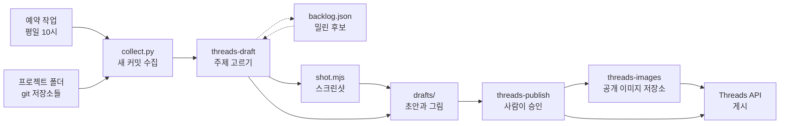

<div align="center">

<h1>thread-manager</h1>

<p>내 프로젝트들의 커밋을 읽고 Threads 글 초안을 써 주는 Claude Code 워크플로.<br/>사람이 승인한 글만 올라간다.</p>

[](scripts/collect.py)
[](scripts/shot.mjs)
[](https://developers.facebook.com/docs/threads)
[](.claude/skills)
[](LICENSE)

[동작 방식](#동작-방식) · [주요 기능](#주요-기능) · [안전 설계](#안전-설계) · [빠른 시작](#빠른-시작)

**한국어** | [English](README.en.md)

</div>

<p align="center">
  
  <br/>
  <sub>예시 초안. 가상의 프로젝트와 가짜 데이터로 만들었다. 초안은 한국어로 쓴다.</sub>
</p>

## 소개

개발은 매일 하는데, 무엇을 만들었는지 밖에 알리는 일은 자꾸 미뤄진다. 커밋 기록에는 이야깃거리가 쌓여 있지만, 그걸 골라 글로 다듬고 스크린샷을 찍어 올리는 데 시간이 든다.

thread-manager는 이 일을 나눠 맡는다. 정해진 시간마다 Claude가 프로젝트 폴더의 새 커밋을 읽고, 올릴 만한 주제를 골라 그림까지 붙인 초안을 써 둔다. 사람은 초안을 보고 올릴지만 정한다. 승인한 글만 Threads 공식 API로 올라간다.

## 동작 방식



1. **수집**: `collect.py`가 프로젝트 폴더 아래의 git 저장소를 모두 찾고, 지난 확인 이후의 커밋과 저장소 공개 여부를 모은다.
2. **초안**: `threads-draft` 스킬이 커밋을 주제로 묶고, 밀려 있던 후보와 함께 `style.md` 기준으로 고른다. 화면이 있는 주제는 배포된 사이트를 찍어 그림을 붙인다. 이 단계는 절대 게시하지 않는다.
3. **승인과 게시**: `threads-publish` 스킬이 초안을 하나씩 보여 준다. 승인한 초안만 그림을 공개 저장소에 올린 뒤 Threads에 게시한다.

## 주요 기능

- **저장소 자동 탐색**: 정해 둔 목록 없이 매번 프로젝트 폴더를 새로 본다. 새 프로젝트도 자동으로 들어온다.
- **주제 고르기**: 출시, 새 기능, 해결한 문제, 진척 순으로 가치를 매겨 한 번에 3개까지 초안을 쓴다. 설정 변경이나 운영 작업은 고르지 않는다.
- **후보 목록**: 상한에 밀린 주제는 버리지 않고 쌓아 두었다가 다음 실행에서 다시 고른다. 14일이 지나면 버린다.
- **그림 준비**: 배포된 사이트나 데모 화면을 데스크톱·휴대폰 크기로 찍고, 저장소에 있는 그림도 쓴다. 찍은 그림은 Claude가 열어 보고 쓸지 정한다.
- **이미지·캐러셀·이어지는 글**: 그림 1장이면 이미지 글, 2장 이상이면 넘겨 보는 캐러셀로 올린다. 긴 글은 답글로 이어 붙인다.
- **반려에서 배우기**: 반려하며 남긴 이유가 `style.md`에 쌓여 다음 초안의 기준이 된다.
- **토큰 관리**: 60일짜리 토큰을 게시할 때 알아서 갱신한다.

## 안전 설계

- **승인 없이는 올리지 않는다.** 예약 실행은 초안만 쓴다. 게시 명령은 `status: approved`인 초안만 받고, 승인은 사용자가 대화에서 직접 한다.
- **비공개 저장소를 구분한다.** 공개 저장소가 아니면 초안에 저장소 링크와 공개 전 세부 내용을 넣지 않고, 개발 서버 화면도 찍지 않는다. 검토할 때 비공개 출처라고 따로 알린다.
- **초안을 검사한다.** 빠진 항목, 내부 경로나 토큰처럼 보이는 문자열, 글자 수(이모지는 바이트로 셈), 이미지 형식과 크기를 게시 전에 확인한다.
- **그림은 승인 뒤에만 공개된다.** 반려한 초안의 그림은 어디에도 올라가지 않는다.
- **실행 데이터는 git에 넣지 않는다.** 토큰, 저장소별 확인 지점, 후보 목록, 초안은 모두 무시 목록에 있다.

## 기술 스택

- **실행 환경**: Claude Code (프로젝트 스킬, 데스크톱 앱 예약 작업)
- **스크립트**: Python 3 표준 라이브러리 (`collect.py`, `threads.py`), Node.js와 Playwright (`shot.mjs`)
- **외부 서비스**: Threads API, GitHub CLI(`gh`, 저장소 공개 여부 확인과 이미지 업로드)

## 빠른 시작

준비물: Claude Code, Python 3, Node.js, 로그인된 `gh`, 공개 Threads 계정.

1. 프로젝트들이 모여 있는 폴더 안에 받는다. 기본 설정은 이 저장소의 상위 폴더를 프로젝트 폴더로 본다.
   ```bash
   cd <프로젝트 폴더>
   git clone https://github.com/mivomad33/thread-manager.git
   cd thread-manager
   npm install
   npx playwright install chromium
   ```
2. `config.json`의 `images_repo`를 내 이미지용 공개 저장소로, `threads_username`을 내 계정으로 바꾼다.
3. Threads 토큰을 받아 `.env`에 넣는다. 절차는 [개발 문서](DEVELOPMENT.md#threads-토큰-발급-처음-한-번)에 있다.
4. 토큰을 확인한다.
   ```bash
   python3 scripts/threads.py whoami
   ```
5. Claude Code에서 이 폴더를 열고 `/threads-draft`로 초안을 만든 뒤 `/threads-publish`로 검토한다.

주기 실행 설정과 파일 설명은 [개발 문서](DEVELOPMENT.md)에 있다.

## 프로젝트 구조

<details>
<summary>폴더 구조 보기</summary>

```
thread-manager/
├── .claude/skills/
│   ├── threads-draft/      # 커밋 수집 → 주제 고르기 → 초안 쓰기
│   └── threads-publish/    # 초안 검토 → 승인한 것만 게시
├── scripts/
│   ├── collect.py          # 새 커밋과 저장소 공개 여부 수집
│   ├── threads.py          # 초안 검사, 이미지 업로드, 게시, 토큰
│   └── shot.mjs            # 웹 페이지 스크린샷
├── drafts/                 # 초안과 그림 (git에 넣지 않음)
├── config.json             # 프로젝트 폴더, 제외 폴더, 상한
└── style.md                # 고르는 기준과 말투
```

</details>

## 만든 과정

이 프로젝트는 Claude Code와 대화하며 설계하고 만들었고, 실행도 Claude Code 위에서 한다. 판단과 글쓰기는 스킬 문서(`SKILL.md`)에 적힌 지침을 Claude가 따르고, 정확해야 하는 일(커밋 수집, 검사, API 호출)은 스크립트가 맡는다.

Meta 개발자 앱을 만들고 토큰을 받는 과정도 Claude가 앱 안의 브라우저로 진행했다. 사람이 한 일은 로그인과 휴대폰 인증, 약관 동의 허락, 토큰 발급 팝업 승인, Threads 초대 수락이었다.

## 라이선스

[MIT](LICENSE)
