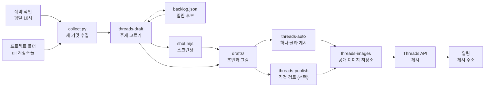

<div align="center">

<h1>thread-manager</h1>

<p>내 프로젝트들의 커밋을 읽고 Threads 글을 써서 올려 주는 Claude Code 워크플로입니다.<br/>평일마다 가장 좋은 글 하나를 알아서 올리고, 사람은 올라간 글을 보고 필요하면 지웁니다.</p>

[](scripts/collect.py)
[](scripts/shot.mjs)
[](https://developers.facebook.com/docs/threads)
[](.claude/skills)
[](LICENSE)

[동작 방식](#동작-방식) · [주요 기능](#주요-기능) · [안전 설계](#안전-설계) · [빠른 시작](#빠른-시작)

**한국어** | [English](README.en.md)

</div>

<p align="center">
  
  <br/>
  <sub>예시 초안입니다. 초안은 한국어로 씁니다.</sub>
</p>

## 소개

개발은 매일 하는데, 무엇을 만들었는지 밖에 알리는 일은 자꾸 미뤄집니다. 커밋 기록에는 이야깃거리가 쌓여 있지만, 그걸 골라 글로 다듬고 스크린샷을 찍어 올리는 데 시간이 듭니다.

thread-manager는 이 일을 대신 맡습니다. 평일 오전 10시마다 Claude가 프로젝트 폴더의 새 커밋을 읽고, 올릴 만한 주제를 골라 그림까지 붙인 초안을 씁니다. 그중 가장 좋은 하나를 골라 Threads 공식 API로 올리고 바로 알려 줍니다. 사람은 올라간 글을 보고 문제가 있을 때만 지웁니다. 직접 검토하고 올리는 방식도 그대로 쓸 수 있습니다.

## 동작 방식



1. **수집**: `collect.py`가 프로젝트 폴더 아래의 git 저장소를 모두 찾고, 지난 확인 이후의 커밋과 저장소 공개 여부를 모읍니다.
2. **초안**: `threads-draft` 스킬이 커밋을 주제로 묶고, 밀려 있던 후보와 함께 `style.md` 기준으로 고릅니다. 화면이 있는 주제는 배포된 사이트를 찍어 그림을 붙입니다. 이 단계는 게시하지 않습니다.
3. **자동 게시**: `threads-auto` 스킬이 아직 올리지 않은 초안을 다시 확인하고 가장 좋은 하나를 골라, 그림을 공개 저장소에 올린 뒤 Threads에 게시합니다. 게시 주소는 바로 알림으로 옵니다.
4. **사후 확인**: 올라간 글에 문제가 있으면 Threads에서 지우고 이유를 알려 주면 됩니다. 이유는 `style.md`에 쌓입니다. 고르지 않고 남은 초안은 `threads-publish`로 직접 검토해 올릴 수 있습니다.

## 주요 기능

- **저장소 자동 탐색**: 정해 둔 목록 없이 매번 프로젝트 폴더를 새로 봅니다. 새 프로젝트도 자동으로 들어옵니다.
- **주제 고르기**: 출시, 새 기능, 해결한 문제, 진척 순으로 가치를 매겨 한 번에 3개까지 초안을 씁니다. 설정 변경이나 운영 작업은 고르지 않습니다.
- **후보 목록**: 상한에 밀린 주제는 버리지 않고 쌓아 두었다가 다음 실행에서 다시 고릅니다. 14일이 지나면 버립니다.
- **그림 준비**: 배포된 사이트나 데모 화면을 데스크톱·휴대폰 크기로 찍고, 저장소에 있는 그림도 씁니다. 찍은 그림은 Claude가 열어 보고 쓸지 정합니다.
- **이미지·캐러셀·이어지는 글**: 그림 1장이면 이미지 글, 2장 이상이면 넘겨 보는 캐러셀로 올립니다. 긴 글은 답글로 이어 붙입니다.
- **하루 하나 자동 게시**: 남은 초안 중 가치가 가장 큰 하나만 올립니다. 기준에 맞는 초안이 없거나 오늘 이미 올렸으면 건너뜁니다.
- **지운 글과 반려에서 배우기**: 지우거나 반려한 이유가 `style.md`에 쌓여 다음 초안과 선택의 기준이 됩니다.
- **토큰 관리**: 60일짜리 토큰을 게시할 때 알아서 갱신합니다.

## 안전 설계

- **자동 게시는 사후 확인을 전제로 합니다.** 게시 전에 사람이 보지 않으므로 하루 1개까지만 올리고, 올리자마자 게시 주소를 알려 줍니다. Threads 글은 올린 뒤 몇 분 안에만 고칠 수 있어서, 그 뒤에는 지우는 것으로 바로잡습니다. `config.json`의 `auto_publish`를 `false`로 바꾸면 초안만 만듭니다.
- **올리기 전에 다시 확인합니다.** 고를 때 본문의 사실을 커밋으로 확인하고, 그림을 다시 열어 보고, 이미 올린 글과 겹치지 않는지 봅니다. 하나라도 걸리면 그 초안은 올리지 않습니다.
- **비공개 저장소를 구분합니다.** 공개 저장소가 아니면 초안에 저장소 링크와 공개 전 세부 내용을 넣지 않고, 개발 서버 화면도 찍지 않습니다.
- **초안을 검사합니다.** 빠진 항목, 내부 경로나 토큰처럼 보이는 문자열, 글자 수(이모지는 바이트로 셈), 이미지 형식과 크기, 본문 링크가 열리는지를 게시 전에 확인합니다.
- **그림은 게시할 때만 공개됩니다.** 올리지 않은 초안의 그림은 어디에도 올라가지 않습니다. 한 번 올린 그림은 글을 지워도 공개 저장소에 남습니다.
- **실행 데이터는 git에 넣지 않습니다.** 토큰, 저장소별 확인 지점, 후보 목록, 초안은 모두 무시 목록에 있습니다.

## 기술 스택

- **실행 환경**: Claude Code (프로젝트 스킬, 데스크톱 앱 예약 작업)
- **스크립트**: Python 3 표준 라이브러리 (`collect.py`, `threads.py`), Node.js와 Playwright (`shot.mjs`)
- **외부 서비스**: Threads API, GitHub CLI(`gh`, 저장소 공개 여부 확인과 이미지 업로드)

## 빠른 시작

준비물: Claude Code, Python 3, Node.js, 로그인된 `gh`, 공개 Threads 계정.

1. 프로젝트들이 모여 있는 폴더 안에 받습니다. 기본 설정은 이 저장소의 상위 폴더를 프로젝트 폴더로 봅니다.
   ```bash
   cd <프로젝트 폴더>
   git clone https://github.com/mivomad33/thread-manager.git
   cd thread-manager
   npm install
   npx playwright install chromium
   ```
2. `config.json`의 `images_repo`를 내 이미지용 공개 저장소로, `threads_username`을 내 계정으로 바꿉니다.
3. Threads 토큰을 받아 `.env`에 넣습니다. 절차는 [개발 문서](DEVELOPMENT.md#threads-토큰-발급-처음-한-번)에 있습니다.
4. 토큰을 확인합니다.
   ```bash
   python3 scripts/threads.py whoami
   ```
5. Claude Code에서 이 폴더를 열고 `/threads-draft`로 초안을 만든 뒤 `/threads-publish`로 검토해 올려 봅니다.
6. 결과가 마음에 들면 `/threads-auto`를 예약 작업으로 걸어 자동 게시를 시작합니다.

주기 실행 설정과 파일 설명은 [개발 문서](DEVELOPMENT.md)에 있습니다.

## 프로젝트 구조

<details>
<summary>폴더 구조 보기</summary>

```
thread-manager/
├── .claude/skills/
│   ├── threads-draft/      # 커밋 수집 → 주제 고르기 → 초안 쓰기
│   ├── threads-auto/       # 초안 만들기 → 하나 골라 게시 → 알림
│   └── threads-publish/    # 초안 직접 검토 → 승인한 것만 게시
├── scripts/
│   ├── collect.py          # 새 커밋과 저장소 공개 여부 수집
│   ├── threads.py          # 초안 검사, 이미지 업로드, 게시, 토큰
│   └── shot.mjs            # 웹 페이지 스크린샷
├── drafts/                 # 올리지 않은 초안과 그림, archive/에 끝난 초안 (git에 넣지 않음)
├── config.json             # 프로젝트 폴더, 제외 폴더, 상한, 자동 게시
└── style.md                # 고르는 기준과 말투
```

</details>

## 만든 과정

이 프로젝트는 Claude Code와 대화하며 설계하고 만들었고, 실행도 Claude Code 위에서 합니다. 판단과 글쓰기는 스킬 문서(`SKILL.md`)에 적힌 지침을 Claude가 따르고, 정확해야 하는 일(커밋 수집, 검사, API 호출)은 스크립트가 맡습니다.

Meta 개발자 앱을 만들고 토큰을 받는 과정도 Claude가 앱 안의 브라우저로 진행했습니다. 사람이 한 일은 로그인과 휴대폰 인증, 약관 동의 허락, 토큰 발급 팝업 승인, Threads 초대 수락이었습니다.

## 라이선스

[MIT](LICENSE)
